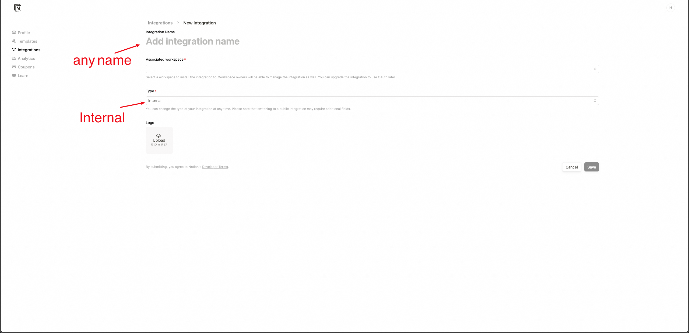

# Notion Hades

A modern personal blog system using Notion as a Headless CMS. Write articles in Notion and they automatically sync to a rendered blog — no backend required, deploy for free on Vercel.


## Features

- 22 Notion Block types rendered as React components (paragraphs, headings, code blocks, tables, bookmarks, audio/video, toggles, column lists, etc.)
- SSR + LRU caching layer to reduce Notion API calls and response latency
- Full-site search (multi-field keyword matching + debounce + Modal overlay)
- Dark / light theme toggle
- Code syntax highlighting with one-click copy
- Table of contents with scroll-spy highlighting
- Auto-playing blog carousel
- Canvas background animation
- Full SEO pipeline: dynamic Sitemap + Cron auto-refresh + JSON-LD structured data + OpenGraph dynamic images
- Fully responsive (desktop + mobile)
- Complete UX states: skeleton loading, empty state, error boundary

## Tech Stack

**Core:** Next.js 15, React 19, TypeScript, Notion API, Tailwind CSS
**Ecosystem:** LRU Cache, next-themes, react-syntax-highlighter, node-html-parser, Vercel

## Architecture

```
src/
├── app/          # App Router pages & API routes (home, posts, search, bookmark, opengraph-image)
├── components/   # UI components (Landing, 30+ components including Notion Block renderers, skeletons)
├── lib/          # Core logic (Notion API client, withCache decorator with LRU caching)
├── models/       # Domain models (Page, Block, Post, RichText, BookMark, Table, TOC)
├── apis/         # Frontend API abstraction layer
├── hooks/        # Custom hooks (useDebounce, useCopy, useActiveSection, useSmoothScroll)
├── icons/        # SVG icon components
├── interfaces/   # TypeScript type definitions
└── config/       # Site configuration
```

## Requirements

Node.js >= 20

## Getting Started

First, create a `.env` file with the following environment variables:

```shell
NOTION_HOME_PAGE_ID=<your Home Page Id>
NOTION_DATABASE_ID=<your Database Id>
NOTION_API_KEY=<your Internal Integration Secret>
```

See [How to get Env Variables](#how-to-get-env-variables) for details.

Then run:

```shell
npm install
npm run dev
```

Open [http://localhost:3000](http://localhost:3000) in your browser to see the result.

## How to get Env Variables

**Step 1:** Click [Notion Hades Template](https://aback-degree-5d2.notion.site/Notion-Hades-1ac985ecc354807192a4fa16c65409a5?pvs=4) to duplicate the Notion database into your workspace.


**Step 2:** Follow the [Notion Authorization docs](https://developers.notion.com/docs/authorization), then visit [Notion Integrations](https://www.notion.so/profile/integrations) to create a new integration.



**Step 3:** Click your integration and copy the `Internal Integration Secret`.


**Step 4:** Go to your Notion database and connect the integration to it.


**Step 5:** Extract the `Home Page ID` and `Database ID` from the share link.


You should get something like:

```plain text
https://www.notion.so/<your Home Page Id>?v=<some hash>&pvs=4

or

https://aback-degree-5d2.notion.site/Notion-Hades-<your Database Id>?pvs=4
```

## Deploy on Vercel

One-click deploy to Vercel. Remember to set `NOTION_HOME_PAGE_ID`, `NOTION_DATABASE_ID`, and `NOTION_API_KEY` in your Vercel environment variables.


For more details, see the [Next.js Deployment documentation](https://nextjs.org/docs/app/building-your-application/deploying).
